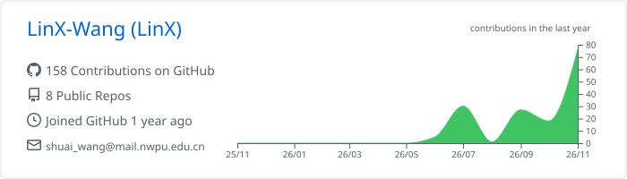

<strong>Shuai Wang</strong> · Direct Ph.D. Student · School of Automation, Northwestern Polytechnical University

  
  

## 👋 About me

I am **Shuai Wang (LinX)**, a first-year direct-entry Ph.D. student at **Northwestern Polytechnical University**, advised by [Prof. Cheng Gong](https://gcheng-nwpu.github.io/). I received my B.Eng. from **Hohai University**.

## 🔬 Research interests

<table>
  <tr>
    <td width="50%" valign="top">
      <h3>🤖 Multimodal Agents</h3>
      
Visual agents, vision-language models, spatial reasoning, and 3D understanding.

    </td>
    <td width="50%" valign="top">
      <h3>🌍 AI for Earth Observation</h3>
      
Remote sensing, geospatial intelligence, and disaster assessment.

    </td>
  </tr>
</table>

## ✨ Beyond research: my little workshop

> **Spot a need. Build it with AI. Use it, polish it, share it.**

Outside research, I enjoy **vibe coding**: teaming up with AI to turn everyday needs into small tools I actually use. A repetitive task, a missing feature, an interface that could feel better — all good excuses to start building.

| 🧩 Small tools, real needs | 🤖 Vibe coding enthusiast | 📚 Notes worth sharing |
| --- | --- | --- |
| Practical tools for my own workflow, built with care. | From a rough idea to something useful — with AI along the way. | Course notes and exam revision materials, freely shared when I have something helpful. |

This GitHub is part research notebook, part personal workshop, and part study-material shelf. Expect useful little projects, experiments, and a few things that started with **“I wish there were a tool for this.”** If something helped me learn or saved me time, I hope it can help someone else too.

## 🛠️ Toolbox

 
 
 
 
 
 
 
 

## 🚀 Selected projects

<table>
  <tr>
    <td width="50%" valign="top">
      <h3>📊 <a href="https://github.com/LinX-Wang/gpt-relay-price-monitor">GPT Relay Price Monitor</a></h3>
      
Self-hosted monitoring for AI relay pricing, balances, token usage, cost, latency, and cache rates.

      Python · TypeScript · HTML
    </td>
    <td width="50%" valign="top">
      <h3>🖥️ <a href="https://github.com/LinX-Wang/linx-remote-manager">LinX Remote</a></h3>
      
Manage remote Codex projects with provider setup, SSH, reverse tunnels, environment preparation, and server resource views.

      Python · Windows · macOS
    </td>
  </tr>
  <tr>
    <td colspan="2" valign="top">
      <h3>🎨 <a href="https://github.com/LinX-Wang/linx-ui">LinX UI · A visual language for my tools</a></h3>
      
A desktop-first UI kit distilled from the tools I use: consistent typography, light and dark themes, orderly layouts, and a distinct maker identity. Small tools deserve a comfortable interface too.

      CSS · JavaScript · Design guidelines
    </td>
  </tr>
  <tr>
    <td colspan="2" valign="top">
      <h3>📚 <a href="https://github.com/LinX-Wang/nwpu-optimization-methods">Optimization Methods · NWPU Ph.D. Course Notes</a></h3>
      
A freely shared study collection compiled in Fall 2026: a revision guide, worked examples, past exams, handwritten notes, practice exercises, and lecture slides. Course taught by Prof. Junfeng Zhao.

      
<a href="https://github.com/LinX-Wang/nwpu-optimization-methods">Explore the materials</a> · <a href="https://github.com/LinX-Wang/nwpu-optimization-methods/blob/main/最优化方法_历年真题.pdf">Browse past exams</a>

      Past exams: Spring 2019 · Spring 2020 · Fall 2023 · Spring 2025 · Spring 2026 · Fall 2026 exam recollections
    </td>
  </tr>
</table>

## 📈 GitHub at a glance

 

 

 

Research with curiosity · Build with AI · Share what helps

